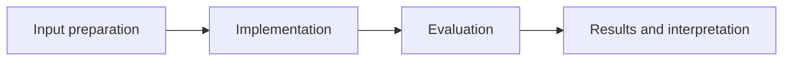

# Abalone Age Regression

**Feras Elghandour** · Technical case study

Estimate abalone ring counts from physical measurements and compare model complexity against multiple error measures.

## Implementation

Train-fitted numeric/categorical preprocessing, a linear baseline, five-fold random-forest grid search, residual plots, feature importance, and sex-group error analysis.



## Evidence and results

The saved 835-row test partition yields linear-regression MAE 1.5906 and tuned-forest MAE 1.5481 rings. Linear regression has slightly better RMSE (2.2162 versus 2.2186) and R² (0.5696 versus 0.5686), so the forest does not improve every metric.

Results described as saved come from the retained experiment record. See [VALIDATION.md](VALIDATION.md) for the checks performed on this release and their scope.

## Fresh reproduction — October 17, 2026

Fresh execution reproduced linear MAE 1.5906 and tuned-forest MAE 1.5481, including the small RMSE/R² advantage for the linear baseline.

The environment versions, input hashes, and notebook hash are recorded in [results/reproduction.json](results/reproduction.json).


## Practical relevance

This project demonstrates train-fitted numeric/categorical preprocessing, a linear baseline, five-fold random-forest grid search, residual plots, feature importance, and sex-group error analysis.
The implementation and evaluation make the trade-offs inspectable for technical review.

## Run locally

```sh
python -m venv .venv
source .venv/bin/activate
python -m pip install -r requirements.txt
jupyter lab analysis.ipynb
```

Prepare the inputs described in [DATA.md](DATA.md) first. Source validation is available without installing model dependencies:

```sh
python scripts/validate_source.py
```

## Limitations

Two zero-height rows are excluded. This is a single random split of one historical dataset; ring-count prediction is not a validated conservation or harvest intervention.

## Development

Changes should include a clear description of the behavior affected and verification appropriate to that behavior. Keep input data, credentials, model caches, and generated artifacts outside version control.
