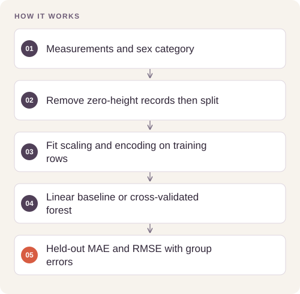
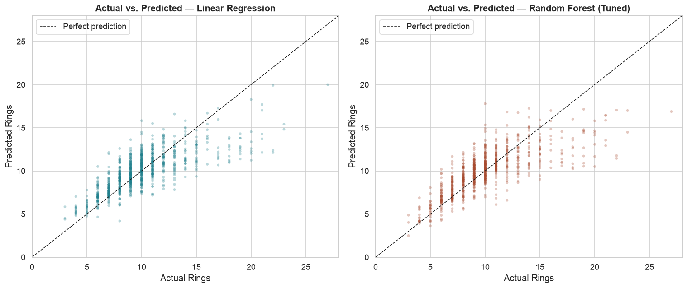

# Abalone Age Regression

Estimate abalone ring counts from physical measurements and compare model complexity against multiple error measures.

## Implementation

Train-fitted numeric/categorical preprocessing, a linear baseline, five-fold random-forest grid search, residual plots, feature importance, and sex-group error analysis.




## Reproduce the full model comparison

The complete retained notebook has been rerun on the real 4,177-row source table through a noninteractive input-aware driver, with source/input hashes, logs and fitted-model export.

[Commands, artifacts and benchmark scope](BENCHMARKS.md) · [Versioned profiles](reproduction.json)


## Try a small example

Generated measurements exercise a baseline preprocessing and regression pattern adapted from the notebook. This does not rerun the UCI dataset experiment or its forest search.

After the local setup below, run from the repository root:

```sh
python examples/quickstart.py
```

The [example source](examples/quickstart.py), [captured output](examples/expected-output.txt) and [execution record](examples/environment.json) keep this demonstration inspectable. Floating-point values may vary with library versions.

Observed output from this run:

```text
{
  "fixture": "generated measurements",
  "train_rows": 48,
  "test_rows": 12,
  "mae": 0.07349028610960955
}
```

## Evidence and results

The saved 835-row test partition yields linear-regression MAE 1.5906 and tuned-forest MAE 1.5481 rings. Linear regression has slightly better RMSE (2.2162 versus 2.2186) and R² (0.5696 versus 0.5686), so the forest does not improve every metric.

See [VALIDATION.md](VALIDATION.md) for the release checks and their scope.

## Fresh reproduction — October 17, 2026

Fresh execution reproduced linear MAE 1.5906 and tuned-forest MAE 1.5481, including the small RMSE/R² advantage for the linear baseline.

The environment versions, input hashes, and notebook hash are recorded in [results/reproduction.json](results/reproduction.json).



## Run locally

```sh
python -m venv .venv
source .venv/bin/activate
python -m pip install -r requirements.txt
jupyter lab analysis.ipynb
```

Prepare the inputs described in [DATA.md](DATA.md) first. Source validation is available without installing model dependencies:

```sh
python scripts/validate_source.py
```

## Limitations

Two zero-height rows are excluded. This is a single random split of one historical dataset; ring-count prediction is not a validated conservation or harvest intervention.
